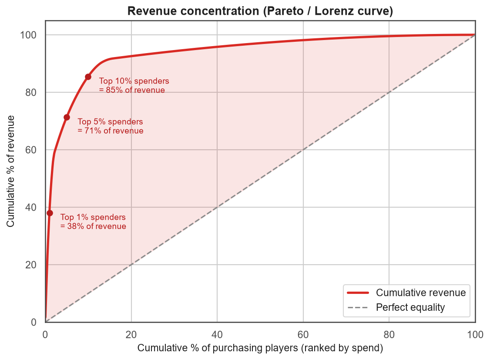
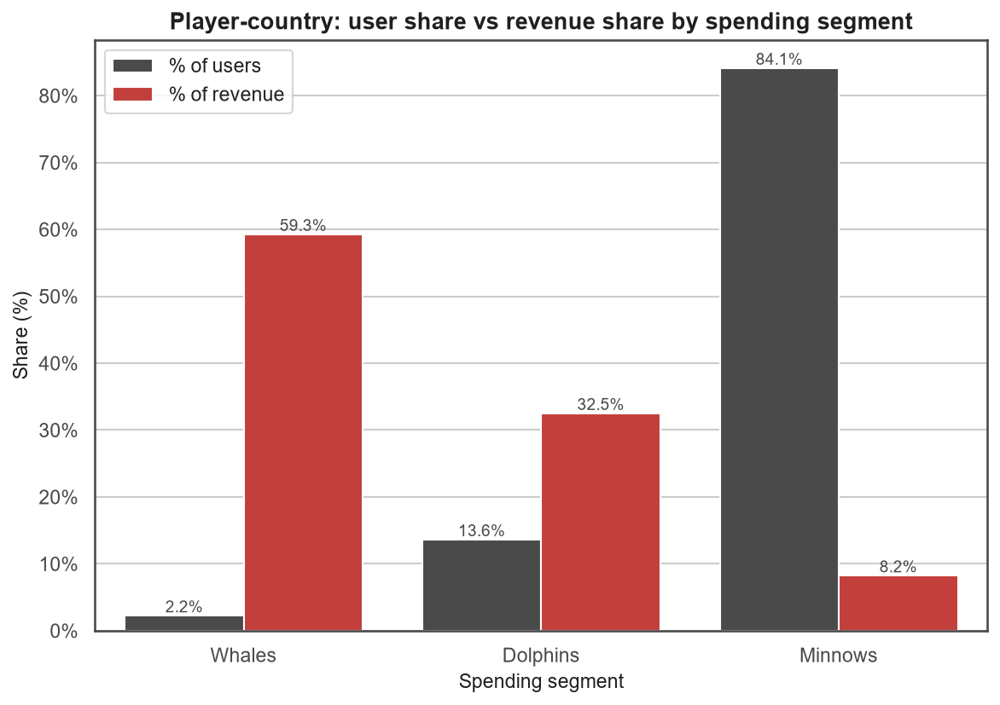
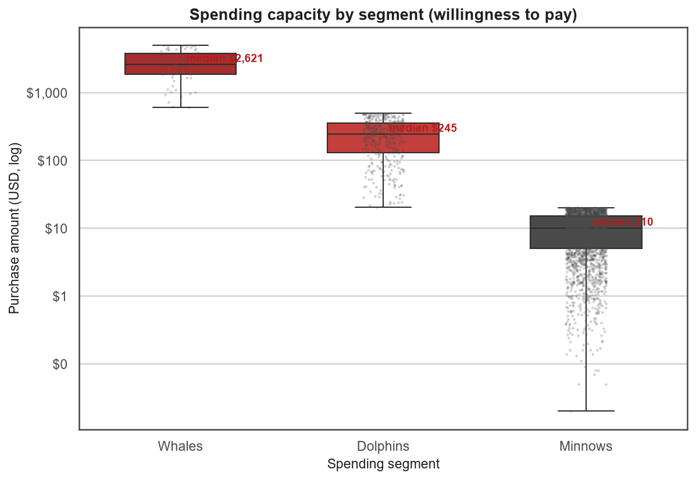
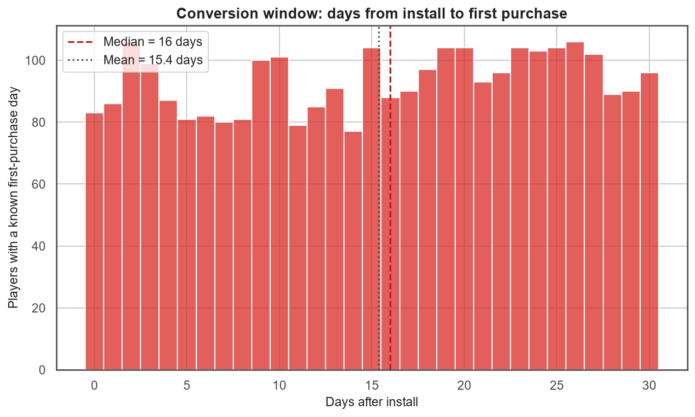
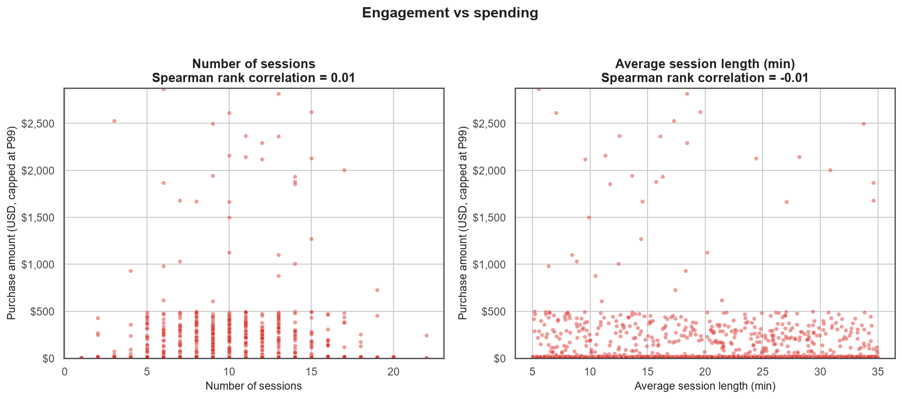
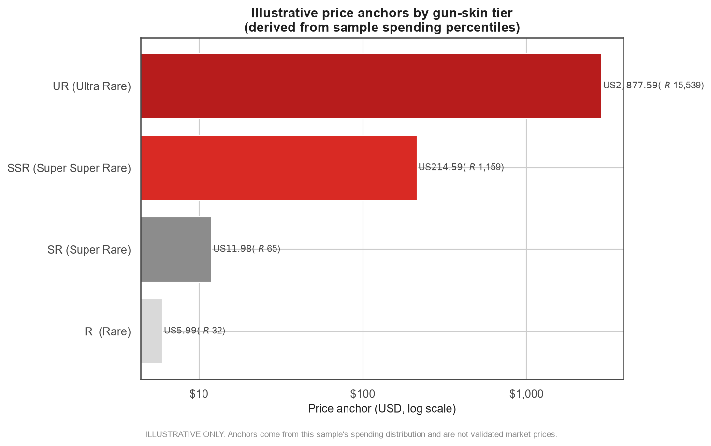

# Relatório EDA — Case Garena Brasil (Skins de Arma)

> **AVISO IMPORTANTE**
> Este documento foi construído **exclusivamente sobre um dataset público
> sintético** (`mobile_game_inapp_purchases.xlsx`, 3.024 registros) usado como
> **ilustração metodológica** para o take-home assignment.
> **Ele NÃO substitui, e não deve ser interpretado como, dados reais da
> Garena.** Números de receita, preços e segmentação servem apenas para
> demonstrar a *lógica analítica* aplicável ao problema real. Qualquer decisão
> deve ser revalidada com os dados internos da empresa.

---

## 1. Contexto do case

A Garena (parte do Sea Limited) atua em 160+ mercados e é forte em títulos
Battle Royale / Action. O case pede uma proposta de **monetização de skins de
arma** para o mercado **brasileiro**, com definição de preço, segmentação e
estratégia de venda.

Este EDA responde a três perguntas que sustentam a proposta:

1. **Quem gasta?** → segmentação por poder de compra (whales/dolphins/minnows).
2. **Quando gasta?** → janela de conversão (dias até a 1ª compra).
3. **O que sustenta o preço?** → distribuição de gasto para ancorar tiers.

---

## 2. Fonte dos dados e limitações

| Item | Detalhe |
|---|---|
| Arquivo | `data/raw/archive/mobile_game_inapp_purchases.xlsx` |
| Registros | 3.024 linhas / 3.024 usuários únicos |
| Compras registradas | 2.888 (95,5%) |
| Colunas | 13 (demografia, engajamento, gasto, pagamento) |
| Natureza | **Dataset público sintético — não são dados da Garena** |

**Limitações explícitas:**

- Amostra pequena e global; Brasil tem apenas **105 registros** (3,5%).
- Apenas **1 whale** no recorte Brasil → base insuficiente para conclusões
  locais robustas; por isso o benchmark LATAM/global é usado como *proxy*.
- Valores em USD; conversão para BRL usada apenas como referência
  (**US$ 1 ≈ R$ 5,40**, hipótese declarada, não cotação de mercado).
- Correlação ≠ causalidade.

---

## 3. Pipeline e reprodutibilidade

```
src/monetization_garena/eda.py        # módulo de EDA (paleta Garena, labels em EN)
scripts/run_garena_eda.py             # entrypoint
reports/figures/                      # 15 figuras PNG
reports/tables/                       # 5 tabelas CSV
```

Execução:

```bash
python scripts/run_garena_eda.py
```

Paleta Garena usada nas figuras: `#D92A24` (vermelho), `#B71C1C`
(vermelho escuro), `#4A4A4A` (grafite).

---

## 4. Resultados principais

### 4.1 Concentração de receita (Pareto / curva de Lorenz)

| Grupo de gastadores | % da receita |
|---|---|
| Top 1% | **38,1%** |
| Top 5% | **71,3%** |
| Top 10% | **85,5%** |

➡️ **Insight:** monetização é dominada por uma cauda minúscula de alto gasto.
A estratégia de skins deve ter **topo de linha caro** para capturar essa cauda
e um **ticket barato** para converter a base.



### 4.2 Segmentação: usuários vs receita

| Segmento | Usuários | % usuários | Receita (US$) | % receita | ARPU (US$) |
|---|---|---|---|---|---|
| **Whales** | 68 | 2,2% | 175.583,1 | **59,3%** | 2.582,1 |
| **Dolphins** | 412 | 13,6% | 96.288,8 | 32,5% | 233,7 |
| **Minnows** | 2.544 | 84,1% | 24.387,4 | 8,2% | 9,6 |

➡️ **Insight:** 2,2% dos usuários geram 59% da receita. Whales + Dolphins
(≈16% dos usuários) = **91,8% da receita**. Minnows são volume, não receita.



### 4.3 Capacidade de gasto (willingness to pay)

| Segmento | n | Média (US$) | Mediana (US$) | Máx (US$) |
|---|---|---|---|---|
| Whales | 63 | 2.787,03 | 2.620,84 | 4.964,45 |
| Dolphins | 392 | 245,63 | 244,59 | 497,91 |
| Minnows | 2.432 | 10,03 | 10,09 | 20,00 |

➡️ Os segmentos são **quase disjuntos** (Minnows ≤ US$20; Dolphins ~US$250;
Whales até ~US$5k) — ótimo para desenhar **tiers com preços ancorados**.



### 4.4 Percentis de gasto (base dos preços)

| Percentil | Gasto (US$) |
|---|---|
| P25 | 5,99 |
| P50 | 11,98 |
| P75 | 17,76 |
| P90 | 214,58 |
| P95 | 375,02 |
| P99 | 2.876,60 |

### 4.5 Janela de conversão

| Métrica | Valor |
|---|---|
| Média | 15,4 dias |
| Mediana | 16,0 dias |
| **Moda** | **2 dias** |
| P75 | 23 dias |
| n | 2.888 |

➡️ **Insight:** há um pico de conversão **logo após o install (dia 2)** e a
maioria compra até ~2–3 semanas. A oferta de entrada (skin barata) deve ser
disparada **nos primeiros dias**.



### 4.6 Engajamento × gasto (Spearman)

| Variável | ρ (Spearman) |
|---|---|
| SessionCount | **0,01** |
| AverageSessionLength | **-0,01** |

➡️ **Insight crítico:** tempo de jogo **não prediz gasto** nesta amostra.
Logo, segmentar por engajamento não basta — o gasto é guiado por
**capacidade/segmento**, reforçando a segmentação por SpendingSegment.



### 4.7 Demais figuras de apoio

| # | Figura | O que mostra |
|---|---|---|
| 01 | `01_missing_values.png` | Qualidade dos dados (valores ausentes) |
| 02 | `02_demographics.png` | Distribuição de idade e gênero |
| 03 | `03_top_countries.png` | Países com mais registros (Brasil destacado) |
| 04 | `04_genres.png` | Gêneros do dataset (Battle Royale / Action RPG destacados) |
| 05 | `05_device_payment.png` | Dispositivo e método de pagamento |
| 06 | `06_engagement.png` | Sessões e duração média |
| 07 | `07_iap_distribution.png` | Distribuição do valor de compra (cauda longa) |
| 13 | `13_correlation_heatmap.png` | Correlações de Spearman entre numéricas |
| 14 | `14_brazil_benchmark.png` | Brasil vs LATAM vs resto do mundo |

---

## 5. Ancoragem de preço (ILUSTRATIVA)

Tiers derivados dos percentis de gasto da amostra — **apenas para demonstrar o
método**, não como preço recomendado à Garena.

| Tier | Preço (US$) | ~BRL | Justificativa metodológica |
|---|---|---|---|
| **R (Rare)** | 5,99 | ~R$ 32 | Ponto de entrada (P25) |
| **SR (Super Rare)** | 11,98 | ~R$ 65 | Gasto recorrente (P50) |
| **SSR (Super Super Rare)** | 214,59 | ~R$ 1.159 | Capacidade dolphin (P90) |
| **UR (Ultra Rare)** | 2.877,59 | ~R$ 15.539 | Âncora whale / teto gacha (P99) |



---

## 6. Recomendações para o take-home

1. **Escada de preços em 4 níveis** (R/SR/SSR/UR), com ticket de entrada baixo
   para converter Minnows no **dia 2**.
2. **Âncora de topo (UR)** cara, destinada aos 2% que geram ~60% da receita;
   usar como *status/gacha*, não como produto de volume.
3. **Evento de conversão precoce** (D0–D7) baseado na moda de 2 dias.
4. **Não usar tempo de jogo como proxy de gasto** (ρ ≈ 0) — segmentar por
   poder de compra (SpendingSegment).
5. **Validar tudo com dados reais da Garena** antes de precificar: o Brasil
   neste dataset tem só ~105 registros e 1 whale.

---

## 7. Estrutura de arquivos

```
projeto/
├── data/raw/archive/mobile_game_inapp_purchases.xlsx
├── src/monetization_garena/
│   ├── __init__.py
│   └── eda.py
├── scripts/run_garena_eda.py
├── reports/
│   ├── figures/   (15 PNGs: 01..15)
│   └── tables/    (segment_summary.csv, segment_spend_stats.csv,
│                   brazil_vs_world.csv, price_anchors.csv,
│                   revenue_concentration.csv)
└── requirements.txt
```

---

## 8. Conclusão

O dataset **não representa a Garena** e serve **apenas para ilustrar o raciocínio
analítico**. Ainda assim, a lógica extraída é transferível:

- Receita extremamente concentrada → **precificação com âncora alta**.
- Segmentos com capacidade de gasto separáveis → **tiers claros**.
- Conversão precoce → **ativação nos primeiros dias**.
- Engajamento não explica gasto → **segmentar por monetização, não por tempo**.

Esses quatro pontos formam a espinha dorsal da proposta de monetização de skins
de arma para o Brasil, a ser **revalidada com dados internos da empresa**.
